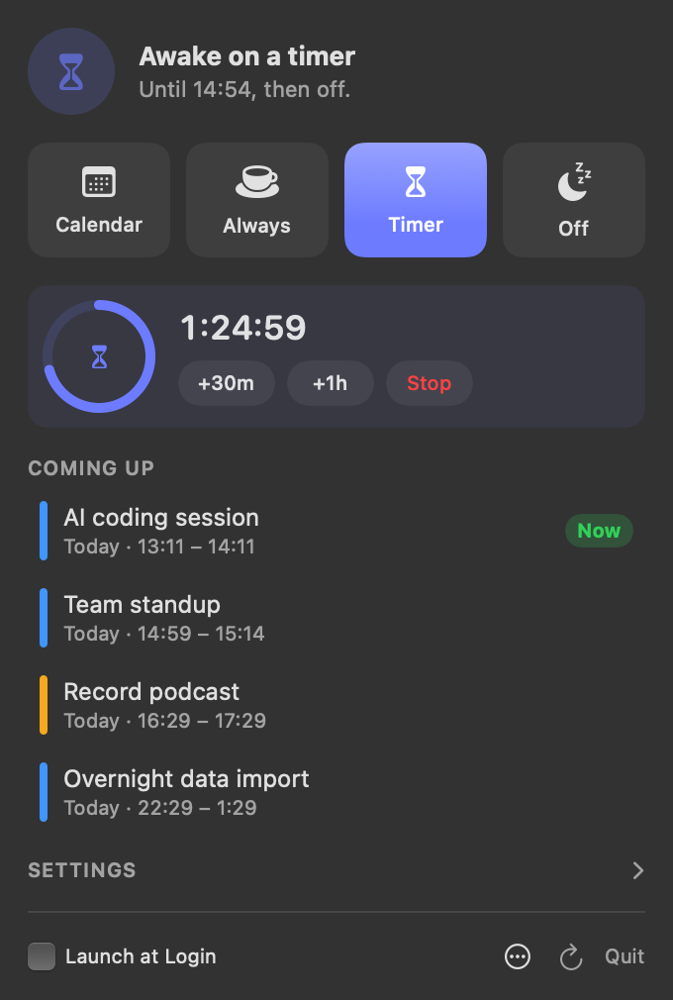

<p align="center"></p>

<h1 align="center">MacAwake</h1>

<p align="center">
  Keep your Mac awake when you need it, and only then.<br>
  <a href="#get-started"><b>⬇︎ Install MacAwake</b></a>
  · Free · Works on any Mac with macOS 14 or later
</p>

<p align="center">
  <a href="https://github.com/dylannlaw/MacAwake/releases/latest"></a>
  <a href="https://github.com/dylannlaw/MacAwake/releases/latest"></a>
  <a href="https://github.com/dylannlaw/MacAwake"></a>
  
  <a href="LICENSE"></a>
</p>

<p align="center">
  
</p>

## Contents

- [Why MacAwake?](#why-macawake)
- [What it can do](#what-it-can-do)
- [Get started](#get-started)
- [Using MacAwake](#using-macawake)
- [Control it from Shortcuts or scripts](#control-it-from-shortcuts-or-scripts)
- [Good to know](#good-to-know)
- [Contributing](#contributing)
- [Technical details](#technical-details)

## Why MacAwake?

More and more work now happens on your Mac while you're away from it. AI assistants write code, tools run long jobs, and apps record and transcribe your meetings. If your Mac falls asleep halfway through, that work stops.

Most keep-awake apps only give you an on/off switch. You either have to remember to turn it on and off, or you leave your Mac awake all the time. MacAwake is more flexible: it keeps your Mac awake for exactly as long as you need.

## What it can do

📅 **Follow your calendar.** Your Mac stays awake during calendar events and sleeps normally the rest of the time. For example, block an hour for a long AI task and your Mac stays awake for that hour.

🤖 **Stay awake while your apps are working.** Pick the apps or tools to watch, such as an AI coding agent. Your Mac stays awake while they're busy and sleeps a few minutes after they finish.

⏳ **Stay awake for a set time.** Choose anything from 30 minutes to 12 hours. Add more time if you need it. When the time is up, or you press Stop, MacAwake turns off and your Mac sleeps as usual.

☕ **Stay awake until you say stop.** For when you just want your Mac to stay on.

💻 **Keep running with the lid closed.** On a MacBook, you can close the lid and walk away while MacAwake keeps your Mac awake, even on battery. Your AI agent or long job keeps going.

⏰ **Wake your Mac for your next event.** If your Mac has gone to sleep, MacAwake can wake it up just before your next event starts.

🌙 **Off.** Your Mac sleeps as usual.

🤖 **Stay awake while a job runs.** Start a long task from the Terminal or Shortcuts, and MacAwake keeps your Mac awake until it finishes, then goes back to what it was doing.

## Get started

1. Open **Terminal** (press ⌘ Space, type "Terminal" and press Return).
2. Copy this line, paste it into Terminal and press Return:

   ```
   curl -fsSL https://github.com/dylannlaw/MacAwake/releases/latest/download/install.sh | bash
   ```

   It downloads the newest MacAwake, checks that the download is complete and unchanged, puts it in your **Applications** folder and opens it. If it asks for a password, type your Mac password (nothing shows as you type) and press Return.
3. When asked, allow MacAwake to see your calendars.

Installing this way means your Mac doesn't block the app, so there's no trip to System Settings to allow it.

MacAwake now lives in the menu bar at the top of your screen; look for the coffee cup ☕. It doesn't appear in the Dock.

**Tip:** in the panel, turn on **Launch at Login** so MacAwake starts every time you turn on your Mac.

## Using MacAwake

Click the coffee cup in the menu bar to open the panel.

<table>
  <tr>
    <td align="center" valign="top"><br><sub><b>Timer:</b> counts down, then turns off</sub></td>
    <td align="center" valign="top"><br><sub><b>Settings</b> opened (Calendar mode)</sub></td>
  </tr>
</table>

**At the top**, you'll see what MacAwake is doing right now. For example: "Awake for an event · until 3:00 PM", or how long the timer has left.

**Choose a mode** by clicking one of the four tiles:

| Tile | What happens |
|---|---|
| **Calendar** | Stays awake during your events (and, if you turn it on, while watched apps are working), sleeps otherwise |
| **Always** | Stays awake until you pick another mode |
| **Timer** | Pick how long (30m to 12h). A ring counts down; use **+30m**, **+1h** or **Stop** at any time |
| **Off** | Your Mac sleeps as usual |

**Coming up** lists your next few events. The one keeping your Mac awake right now is marked **Now**.

**Settings** (click to open) let you:
- Keep the screen on, or let it dim while the Mac stays awake
- Start a few minutes before each event, or stay awake a little after it ends
- Choose whether all-day events (like holidays) count
- Skip events you've marked as "Free"
- Choose which calendars count
- **Stay awake while apps are working**: click **Add** to pick AI agents (like Claude Code or Codex), one of your open apps, or a command by name. For each one, choose **While working** (only while it's busy) or **While open** (whenever it's running), and how long to stay awake after it finishes. This works in Calendar mode.
- Set up **Wake from sleep**. Click **Set Up…** and enter your Mac password once.
- Choose how often a sleeping Mac checks for new events (**Check for new events**: every 5, 15 or 30 minutes, every hour, or never). More often catches last-minute events but uses more battery.
- Protect your battery (MacBooks only): stop keeping the Mac awake when the battery gets low (**Stop below**, 10% to start with), keep it awake **Only when plugged in**, or **Pause in Low Power Mode**
- On a MacBook, turn on **Keep awake with lid closed**. Click **Set Up…** and enter your Mac password once.

**The menu bar icon** tells you the state at a glance:
- ☕ filled: keeping your Mac awake
- ☕ outline: waiting for your next event
- ⏳: timer running
- 🌙: off

## Control it from Shortcuts or scripts

You can start a timer, add time, stop or switch mode without opening the panel. This is handy for automations and for AI tools that run on their own.

- **Shortcuts:** add an **Open URLs** action with a MacAwake link. For example, *macawake://start?minutes=90* keeps your Mac awake for 90 minutes, and *macawake://off* turns MacAwake off. The other links are *extend*, *stop*, *always* and *calendar*.
- **Terminal:** MacAwake includes a small Terminal command. Start a long job through it, such as an AI coding assistant, and your Mac stays awake exactly as long as the job runs.

The full list of links and commands, and how to set up the command, are in the [Technical guide](TECHNICAL.md#automation-urls-and-the-macawake-command).

## Good to know

- **Which calendars?** Any calendar that appears in Apple's Calendar app, including Google, Outlook and Exchange. Add the account in **System Settings › Internet Accounts**.
- **Declined or cancelled events** never keep your Mac awake.
- **Low battery:** on a MacBook running on battery, MacAwake pauses when the charge drops below your limit, in every mode, and lets the Mac sleep. The panel says **Paused** and why. Plug in and it carries on by itself. A timer keeps counting down while paused.
- **Watched apps** only count while the Mac is awake: they can't wake a sleeping Mac, and an AI agent left open but idle doesn't keep it awake when set to **While working**.
- **Closing a MacBook's lid** puts it to sleep as usual, unless you've turned on **Keep awake with lid closed**. With that on, the Mac only stays awake with the lid closed while MacAwake is keeping it awake (for example during an event, while a watched app or command is working, in Always mode or while a timer runs). It goes back to normal as soon as MacAwake stops, and if MacAwake quits or crashes, normal sleep comes back by itself within a few minutes.
- **Don't put your Mac in a bag or sleeve** while it's awake with the lid closed: it can overheat. MacAwake pauses lid-closed mode if the Mac gets too hot, or if the battery drops to 20% (it starts again above 25% or when you plug in). While it's on, choosing **Sleep** from the Apple menu won't put the Mac to sleep.
- **New events while your Mac sleeps:** if you add an event from your phone while the Mac is asleep, MacAwake still catches it. Every 15 minutes (you can change this), it briefly wakes the Mac in the background with the screen off, checks your calendar, and goes back to sleep. So an event added less than 15 minutes before it starts might be missed. Checking works best when the Mac is plugged in; on battery, macOS may stop the check before your calendar has synced.
- **Quitting MacAwake** lets your Mac sleep normally again and cancels any planned wake-up.
- **Updating:** paste the same line into Terminal again. It replaces the old version and keeps your settings. If your events stop showing afterwards, allow calendar access again.

## Contributing

Ideas and fixes are welcome. See **[Contributing](CONTRIBUTING.md)** for how to suggest a change. If you find a security problem, please report it privately as described in **[Security](SECURITY.md)**.

## Technical details

How it works under the hood, building from source, releases, signing and troubleshooting are all in the **[Technical guide](TECHNICAL.md)**.
