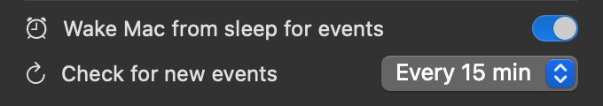
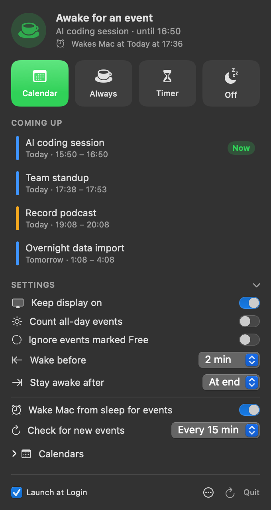

<p align="center"></p>

<h1 align="center">MacAwake</h1>

<p align="center">
  Keep your Mac awake when you need it, and only then.<br>
  <a href="#get-started"><b>⬇︎ Install MacAwake</b></a>
  · Free · Works on any Mac with macOS 14 or later
</p>

<p align="center">
  <a href="https://github.com/dylannlaw/MacAwake/releases/latest"></a>
  <a href="https://github.com/dylannlaw/MacAwake/releases/latest"></a>
  <a href="https://github.com/dylannlaw/MacAwake"></a>
  
  <a href="LICENSE"></a>
</p>

<p align="center">
  
</p>

## Contents

- [Why MacAwake?](#why-macawake)
- [What it can do](#what-it-can-do)
- [Get started](#get-started)
- [Using MacAwake](#using-macawake)
- [Good to know](#good-to-know)
- [Contributing](#contributing)
- [Technical details](#technical-details)

## Why MacAwake?

More and more work now happens on your Mac while you're away from it. AI assistants write code, tools run long jobs, and apps record and transcribe your meetings. If your Mac falls asleep halfway through, that work stops.

Most keep-awake apps only give you an on/off switch. You either have to remember to turn it on and off, or you leave your Mac awake all the time. MacAwake is more flexible: it keeps your Mac awake for exactly as long as you need.

## What it can do

Click a feature to read how it works and when to use it.

<table>
  <tr>
    <td width="50%" valign="top">
      <h3>📅 <a href="docs/features/calendar.md">Follow your calendar</a></h3>
      Your Mac stays awake during calendar events and sleeps normally the rest of the time. Block an hour for a long AI task and your Mac stays awake for that hour.<br><br>
      <a href="docs/features/calendar.md"></a>
    </td>
    <td width="50%" valign="top">
      <h3>⏳ <a href="docs/features/timer.md">Stay awake for a set time</a></h3>
      Choose anything from 30 minutes to 12 hours, and add more time if you need it. When the time is up, or you press Stop, MacAwake turns off.<br><br>
      <a href="docs/features/timer.md"></a>
    </td>
  </tr>
  <tr>
    <td width="50%" valign="top">
      <h3>☕ <a href="docs/features/always-on.md">Stay awake until you say stop</a></h3>
      For when you just want your Mac to stay on, with no timer and no calendar.<br><br>
      <a href="docs/features/always-on.md"></a>
    </td>
    <td width="50%" valign="top">
      <h3>🌙 <a href="docs/features/off.md">Off</a></h3>
      Your Mac sleeps as usual. MacAwake waits in the menu bar until you need it again.<br><br>
      <a href="docs/features/off.md"></a>
    </td>
  </tr>
  <tr>
    <td width="50%" valign="top">
      <h3>⏰ <a href="docs/features/wake-from-sleep.md">Wake your Mac for your next event</a></h3>
      If your Mac has gone to sleep, MacAwake wakes it up just before your next event, and checks now and then for events you added while it slept.<br><br>
      <a href="docs/features/wake-from-sleep.md"></a>
    </td>
    <td width="50%" valign="top">
      <h3>⚙️ <a href="docs/features/settings.md">Settings and the menu bar</a></h3>
      Keep the screen on or let it dim, start early or finish late, choose which calendars count, and read the menu bar icon at a glance.<br><br>
      <a href="docs/features/settings.md"></a>
    </td>
  </tr>
</table>

## Get started

1. Open **Terminal** (press ⌘ Space, type "Terminal" and press Return).
2. Copy this line, paste it into Terminal and press Return:

   ```
   curl -fsSL https://github.com/dylannlaw/MacAwake/releases/latest/download/install.sh | bash
   ```

   It downloads the newest MacAwake, checks that the download is complete and unchanged, puts it in your **Applications** folder and opens it. If it asks for a password, type your Mac password (nothing shows as you type) and press Return.
3. When asked, allow MacAwake to see your calendars.

Installing this way means your Mac doesn't block the app, so there's no trip to System Settings to allow it.

MacAwake now lives in the menu bar at the top of your screen; look for the coffee cup ☕. It doesn't appear in the Dock.

**Tip:** in the panel, turn on **Launch at Login** so MacAwake starts every time you turn on your Mac.

## Using MacAwake

Click the coffee cup in the menu bar to open the panel.

- **At the top**, you'll see what MacAwake is doing right now. For example: "Awake for an event · until 3:00 PM", or how long the timer has left.
- **Choose a mode** by clicking one of the four tiles: [Calendar](docs/features/calendar.md), [Always](docs/features/always-on.md), [Timer](docs/features/timer.md) or [Off](docs/features/off.md).
- **Coming up** lists your next few events. The one keeping your Mac awake right now is marked **Now**.
- **Settings** (click to open) holds the options for calendar events and [waking from sleep](docs/features/wake-from-sleep.md). Every option is explained in [Settings and the menu bar](docs/features/settings.md).

**The menu bar icon** tells you the state at a glance:
- ☕ filled: keeping your Mac awake
- ☕ outline: waiting for your next event
- ⏳: timer running
- 🌙: off

## Good to know

- **Which calendars?** Any calendar that appears in Apple's Calendar app, including Google, Outlook and Exchange. Add the account in **System Settings › Internet Accounts**.
- **Declined or cancelled events** never keep your Mac awake.
- **Closing a MacBook's lid** still puts it to sleep, unless it's connected to power and an external display.
- **New events while your Mac sleeps:** if you add an event from your phone while the Mac is asleep, MacAwake still catches it by briefly checking your calendar every 15 minutes (you can change this). An event added less than 15 minutes before it starts might be missed. See [Wake from sleep](docs/features/wake-from-sleep.md#catching-events-added-while-your-mac-sleeps).
- **Quitting MacAwake** lets your Mac sleep normally again and cancels any planned wake-up.
- **Updating:** paste the same line into Terminal again. It replaces the old version and keeps your settings. If your events stop showing afterwards, allow calendar access again.

## Contributing

Ideas and fixes are welcome. See **[Contributing](CONTRIBUTING.md)** for how to suggest a change. If you find a security problem, please report it privately as described in **[Security](SECURITY.md)**.

## Technical details

How it works under the hood, building from source, releases, signing and troubleshooting are all in the **[Technical guide](TECHNICAL.md)**.
