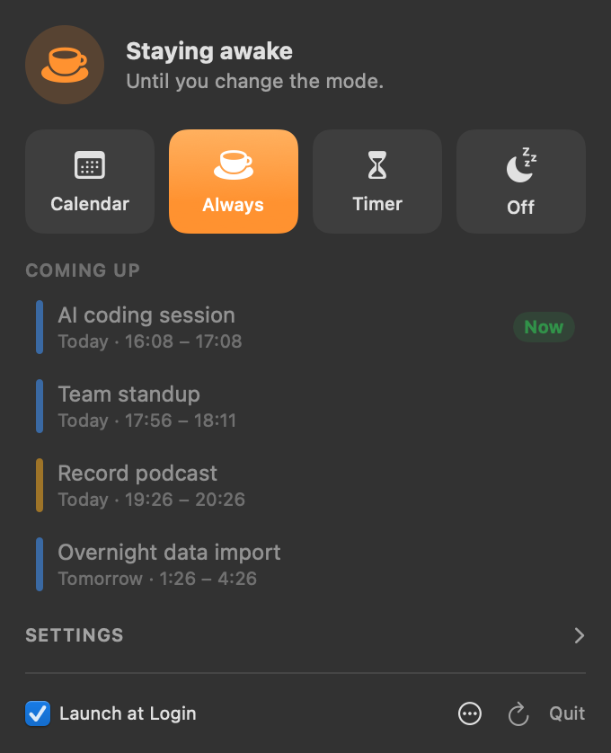

# ☕ Always on

[← Back to the README](../../README.md#what-it-can-do)

Always on keeps your Mac awake until you pick another mode. There's no timer and no calendar: it just stays on.

  

## When to use it

- You're using your Mac as a server or for a job with no clear end.
- You're giving a presentation and don't want any surprises.
- You simply want the old-style on/off switch.

## How to turn it on

Click the menu bar coffee cup ☕ to open the panel, then click the **Always** tile. The header changes to **Staying awake** and the menu bar shows a filled cup ☕.

## How to turn it off

Pick any other tile: **Calendar** to go back to following your events, or **Off** to let your Mac sleep as usual. Quitting MacAwake also lets your Mac sleep again.

## Good to know

- Always on uses more battery than the other modes, because your Mac never sleeps. If you know how long you need, a [Timer](timer.md) turns itself off.
- **Coming up** still lists your events, but in this mode they don't change anything.
- **Closing a MacBook's lid** puts it to sleep as usual, unless you turn on [Keep awake with lid closed](lid-closed.md). Don't put a Mac that's awake with its lid closed in a bag: it can overheat.
- To keep the screen from dimming as well, turn on **Keep display on** in [Settings](settings.md).

## Related

- [Timer](timer.md): stay awake for a set time instead.
- [Calendar mode](calendar.md): stay awake only during events.
