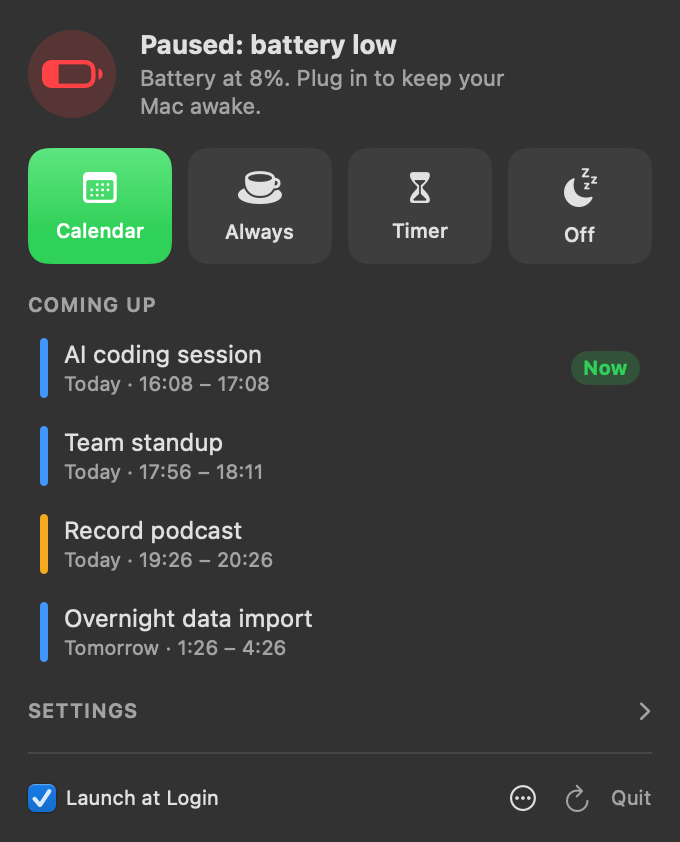
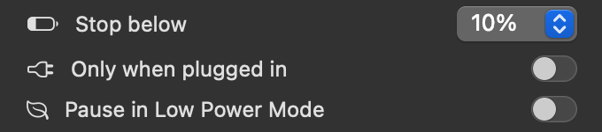

# 🔋 Protect your battery

[← Back to the README](../../README.md#what-it-can-do)

On a MacBook, keeping the Mac awake uses battery. MacAwake can pause on its own when the battery runs low, so it never drains your Mac flat. It picks up again by itself when you plug in.

  

## The settings

Open the panel, click **Settings**, and you'll find three battery options:

  

| Setting | What it does | Starts as |
|---|---|---|
| **Stop below** | On battery, stops keeping your Mac awake once the charge drops below this. Choose 10%, 20%, 30%, 50% or Never. | 10% |
| **Only when plugged in** | Keeps your Mac awake only while it's on the power adapter. | Off |
| **Pause in Low Power Mode** | Pauses while Low Power Mode is on and the Mac is on battery. | Off |

## What you'll see

- **Paused** at the top of the panel, with the reason and what to do, for example "Battery at 8%. Plug in to keep your Mac awake."
- A red battery icon for a low battery, or a yellow one for the other two settings. The menu bar icon becomes a battery too.
- When you plug in, the pause ends straight away and MacAwake carries on.

## Good to know

- The battery settings work in every mode. Your chosen mode doesn't change while paused.
- **A timer keeps counting down while paused.** If it was set to end at 3:00 PM, it still ends at 3:00 PM.
- Once the battery drops below your limit, MacAwake stays paused until you plug in, even if the reading goes back up a little.
- While paused, MacAwake doesn't wake a sleeping Mac to look for new events, to save charge. It still wakes it for your next event, in case you've plugged in by then.
- Desktop Macs don't show these settings.
- [Keep running with the lid closed](lid-closed.md) has its own, stricter limit on top: it pauses at 20%.

## Related

- [Keep running with the lid closed](lid-closed.md) · [Settings](settings.md)
- The [Technical guide](../../TECHNICAL.md#testing-the-battery-safeguards) explains how to test it.
