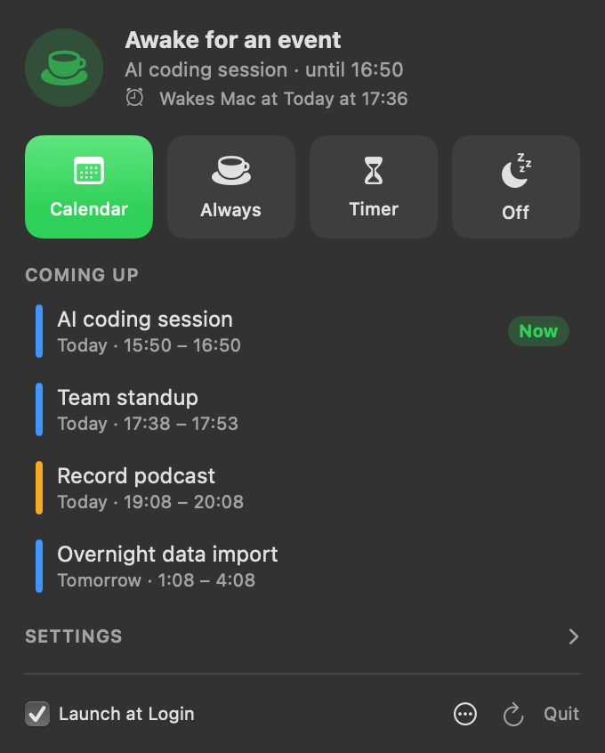
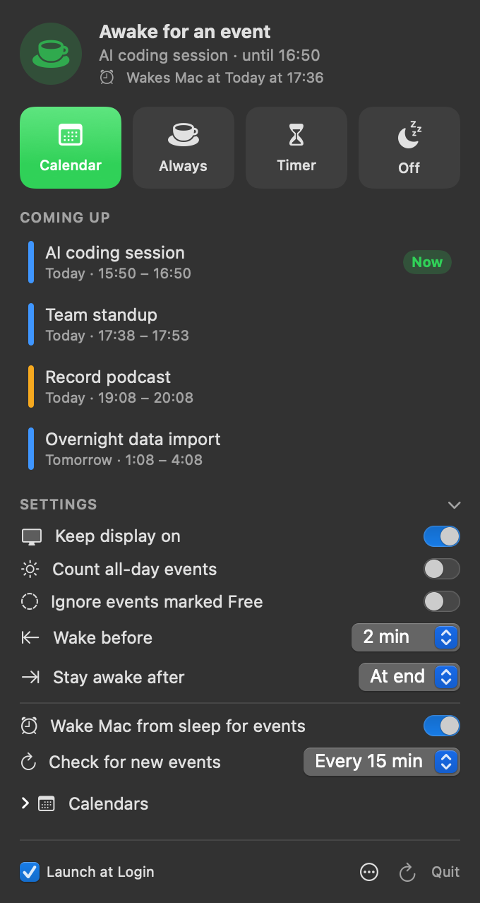

# 📅 Calendar mode

[← Back to the README](../../README.md#what-it-can-do)

In Calendar mode, your Mac stays awake while a calendar event is happening and sleeps normally the rest of the time. You plan when your Mac needs to be awake the same way you plan your day: by putting it in your calendar.

  

## When to use it

- **Long AI or computer tasks.** Block an hour called "AI coding session" and your Mac stays awake while the assistant works, even if you walk away.
- **Meetings you record or transcribe.** Your Mac won't fall asleep halfway through a call.
- **Overnight jobs.** Add an event for a backup, download or import, and your Mac stays up for it.

## How to turn it on

Click the menu bar coffee cup ☕ to open the panel, then click the **Calendar** tile. The first time, MacAwake asks to see your calendars; click **Allow**.

## What you'll see

- **At the top:** what MacAwake is doing right now. During an event it says **Awake for an event** with the event's name and when it ends. Between events it says when the next one starts.
- **Coming up:** your next few events. The one keeping your Mac awake right now is marked **Now**. The coloured bar beside each event is its calendar's colour.
- **The menu bar icon:** a filled cup ☕ while it's keeping your Mac awake, an outline cup while it's waiting for the next event.

## Which events count

- Events from any calendar in Apple's Calendar app count, including Google, Outlook and Exchange calendars. Add the account in **System Settings › Internet Accounts**.
- **Declined or cancelled events** never keep your Mac awake.
- **All-day events** (like holidays or birthdays) don't count unless you turn on **Count all-day events**.
- Turn on **Ignore events marked Free** to skip events you've set to show as "Free".
- Under **Calendars**, choose which calendars count. For example, count your work calendar but not a shared family one.

## Starting early and finishing late

In **Settings**, two options stretch each event a little:

- **Wake before:** stay awake from a few minutes before the event starts (at start, or 1 to 15 minutes before).
- **Stay awake after:** keep going for a few minutes after the event ends (at end, or 1 to 15 minutes after).

  

## Good to know

- Calendar mode keeps a Mac that's already awake from falling asleep. If your Mac has already gone to sleep, turn on [Wake from sleep](wake-from-sleep.md) so MacAwake can wake it for the next event.
- **Closing a MacBook's lid** still puts it to sleep, unless it's connected to power and an external display.
- If no events show up, check that MacAwake is allowed to see your calendars in **System Settings › Privacy & Security › Calendars**.

## Related

- [Wake from sleep](wake-from-sleep.md): wake a sleeping Mac in time for your next event.
- [Settings](settings.md): every option in the panel.
