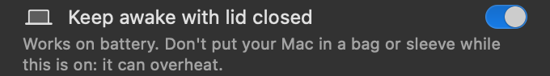

# 💻 Keep running with the lid closed

[← Back to the README](../../README.md#what-it-can-do)

Normally a MacBook goes to sleep as soon as you close the lid. With this setting on, you can close the lid and walk away while MacAwake is keeping your Mac awake, even on battery and with no screen attached. Your AI agent or long job keeps going.

  

## When to use it

- An AI agent is working and you want to put the MacBook away while it finishes.
- A long download or export should keep going while you carry the Mac to another room.

## How to set it up

1. Click the menu bar coffee cup ☕ to open the panel.
2. Click **Settings** to open it.
3. Next to **Keep awake with lid closed**, click **Set Up…**.
4. Read the warning and confirm, then enter your Mac password when asked. You only need to do this once.

Stopping a closed MacBook from sleeping needs a small helper with administrator rights, which is why macOS asks for your password. After that, the setting is a simple switch:

  

## When it applies

Closing the lid only keeps the Mac running while MacAwake is keeping your Mac awake: during an event, while a [watched app](watched-apps.md) or a [job](run-a-job.md) is working, in **Always** mode or while a **Timer** runs. As soon as MacAwake stops, closing the lid puts the Mac to sleep as usual again.

The top of the panel tells you what it's doing:

| You see | Meaning |
|---|---|
| **Lid can be closed** | You can close the lid now. |
| **Turning on lid-closed mode…** | Getting ready. Wait a moment before closing the lid. |
| **Lid-closed paused · battery low** | The battery is at 20% or less. It starts again above 25% or when you plug in. |
| **Lid-closed paused · Mac is hot** | macOS reports the Mac is too hot. It starts again once it cools down. |

## Good to know

- **Don't put your Mac in a bag or sleeve** while it's awake with the lid closed: it can overheat.
- MacBooks only. The setting doesn't appear on desktop Macs.
- While it's on, choosing **Sleep** from the Apple menu won't put the Mac to sleep.
- If MacAwake quits or crashes, normal sleep comes back by itself within a few minutes.
- The [battery settings](battery.md) apply here too: if they pause MacAwake, the lid setting pauses as well.
- To remove the helper, click the **⋯** button at the bottom of the panel and choose **Remove Lid-Closed Helper…**.

## Related

- [Protect your battery](battery.md) · [Stay awake while apps are working](watched-apps.md) · [Settings](settings.md)
- The [Technical guide](../../TECHNICAL.md#lid-closed-the-lid-helper) explains how the helper works and how to check it.
