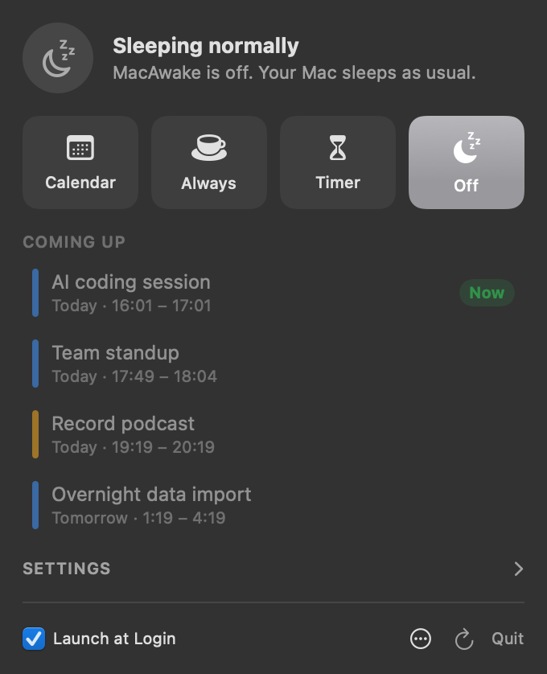

# 🌙 Off

[← Back to the README](../../README.md#what-it-can-do)

Off means MacAwake does nothing: your Mac sleeps exactly as it would without the app.

  

## When to use it

- You don't need your Mac awake for a while and want to save battery.
- You want to pause Calendar mode without quitting the app.

## How to turn it on

Click the menu bar coffee cup ☕ to open the panel, then click the **Off** tile. The header changes to **Sleeping normally** and the menu bar shows a moon 🌙.

A [Timer](timer.md) also switches to Off when it runs out or you press **Stop**.

## Good to know

- MacAwake stays in the menu bar while it's off, so you can switch back to another mode at any time.
- In Off, MacAwake doesn't wake your Mac for events, even if [Wake from sleep](wake-from-sleep.md) is set up.
- **Coming up** still lists your events, so you can see what's next.
- Quitting MacAwake has the same effect as Off, and also cancels any planned wake-up.

## Related

- [Calendar mode](calendar.md): stay awake only during events.
