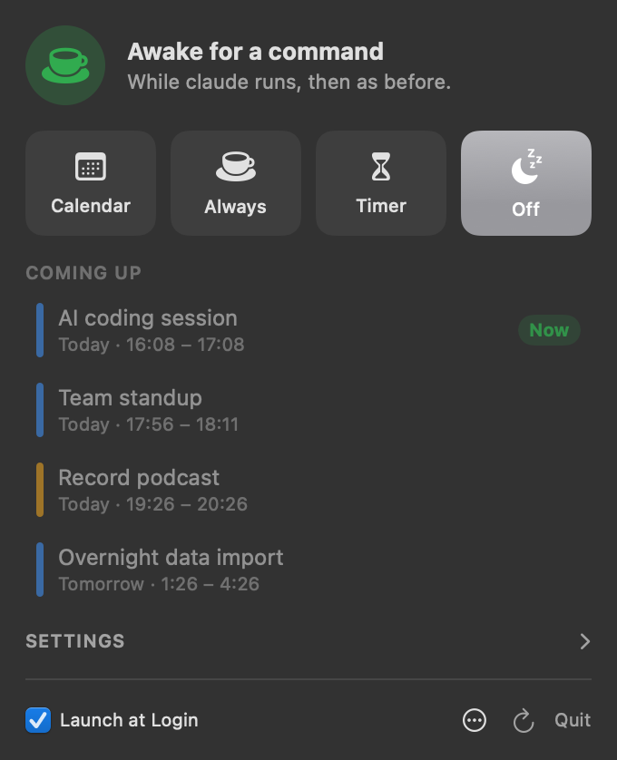

# 🏃 Stay awake while a job runs

[← Back to the README](../../README.md#what-it-can-do)

Start a long task through MacAwake's Terminal command, and your Mac stays awake for exactly as long as that task runs. When it finishes, MacAwake goes back to what it was doing before. Your chosen mode doesn't change.

  

## When to use it

- You start an AI coding agent from the Terminal and want the Mac awake until it's done, even if MacAwake is set to **Off**.
- A script, backup or data import runs from the Terminal or from Shortcuts and takes an unknown amount of time.
- An automation should keep the Mac awake on its own, without you touching the panel.

## How to use it

MacAwake includes a small Terminal command. Once it's set up, you put it in front of the job you want to run, and MacAwake keeps your Mac awake until that job ends. The job itself works exactly as usual: same window, same output, and you can still type into it.

Setting up the command is a one-time step. The [Technical guide](../../TECHNICAL.md#the-macawake-command) has the line to paste into Terminal and examples.

The same command, and MacAwake links in Shortcuts, can also start a timer, add time, stop or switch mode. See [Control it from Shortcuts or scripts](../../README.md#control-it-from-shortcuts-or-scripts).

## What you'll see

- **Awake for a command** at the top of the panel, with the job's name, for example "While claude runs, then as before."
- The mode tiles stay as they were. In the picture above, MacAwake is set to **Off**, and the Mac is awake only because of the job.
- As soon as the job ends, MacAwake goes back to the mode you chose.

## Good to know

- It works in every mode, including **Off**.
- If several jobs are running, your Mac stays awake until the last one finishes.
- If MacAwake isn't open, the command opens it. If that doesn't work, the job still keeps your Mac awake using macOS's own tool.
- If you quit MacAwake while a job is running, MacAwake stops keeping the Mac awake for it.
- To watch an app or agent every time it works, without starting it in a special way, see [Stay awake while apps are working](watched-apps.md).

## Related

- [Stay awake while apps are working](watched-apps.md) · [Timer](timer.md) · [Off](off.md)
- The [Technical guide](../../TECHNICAL.md#automation-urls-and-the-macawake-command) lists every command and link.
