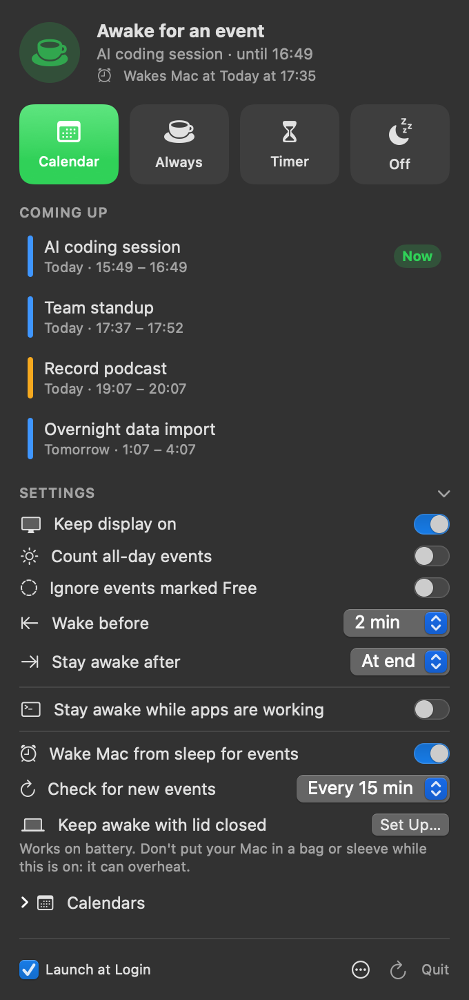

# ⚙️ Settings and the menu bar

[← Back to the README](../../README.md#what-it-can-do)

Everything in MacAwake lives in one panel. Click the coffee cup ☕ in the menu bar to open it, and click **Settings** to see the options.

  

## All settings

| Setting | What it does | Starts as |
|---|---|---|
| **Keep display on** | Keeps the screen on too. Turn it off to let the screen dim and sleep while the Mac itself stays awake. | On |
| **Count all-day events** | Lets all-day events, like holidays, keep your Mac awake. | Off |
| **Ignore events marked Free** | Skips events you've set to show as "Free". | Off |
| **Wake before** | Starts keeping your Mac awake a few minutes before each event. | 2 min |
| **Stay awake after** | Keeps your Mac awake a few minutes after each event ends. | At end |
| **Stay awake while apps are working** | Also keeps your Mac awake while apps or tools you pick, such as an AI coding agent, are busy. Click **Add** to choose one, then pick **While working** or **While open** and how long to stay awake after it finishes. Works in Calendar mode while the Mac is awake; it can't wake a sleeping Mac. | Off |
| **Wake Mac from sleep for events** | Wakes a sleeping Mac before your next event. Needs a one-time **Set Up…**. See [Wake from sleep](wake-from-sleep.md). | On, after setup |
| **Check for new events** | How often a sleeping Mac briefly wakes to look for new events. | Every 15 min |
| **Stop below** | MacBooks only. On battery, stops keeping your Mac awake once the charge drops below this, until you plug in. The panel shows **Paused** while it applies. | 10% |
| **Only when plugged in** | MacBooks only. Keeps your Mac awake only while it's on the power adapter. | Off |
| **Pause in Low Power Mode** | MacBooks only. Pauses keeping awake while Low Power Mode is on and the Mac is on battery. | Off |
| **Keep awake with lid closed** | MacBooks only. Lets your Mac keep running with the lid closed, even on battery, while MacAwake is keeping it awake. Needs a one-time **Set Up…** with your Mac password. Pauses if the Mac gets too hot or the battery drops to 20%. Don't put the Mac in a bag while it's on. | Off |
| **Calendars** | Click to choose which calendars count. | All |

The calendar settings only matter in [Calendar mode](calendar.md). **Keep display on** applies whenever MacAwake is keeping your Mac awake.

## At the bottom of the panel

- **Launch at Login:** start MacAwake every time you turn on your Mac. Recommended.
- **⋯:** appears once Wake from sleep or lid-closed keep-awake is set up, with options to remove their helpers.
- **↻:** check your calendar again now.
- **Quit:** close MacAwake. Your Mac sleeps normally again and any planned wake-up is cancelled.

## The menu bar icon

The icon tells you what MacAwake is doing without opening the panel:

| Icon | Meaning |
|---|---|
| ☕ filled | Keeping your Mac awake |
| ☕ outline | Calendar mode, waiting for the next event |
| ⏳ | A [Timer](timer.md) is running |
| 🌙 | [Off](off.md): your Mac sleeps as usual |

## Related

- [Calendar mode](calendar.md) · [Timer](timer.md) · [Always on](always-on.md) · [Off](off.md) · [Wake from sleep](wake-from-sleep.md)
- The [Technical guide](../../TECHNICAL.md) lists the same settings with their internal names.
