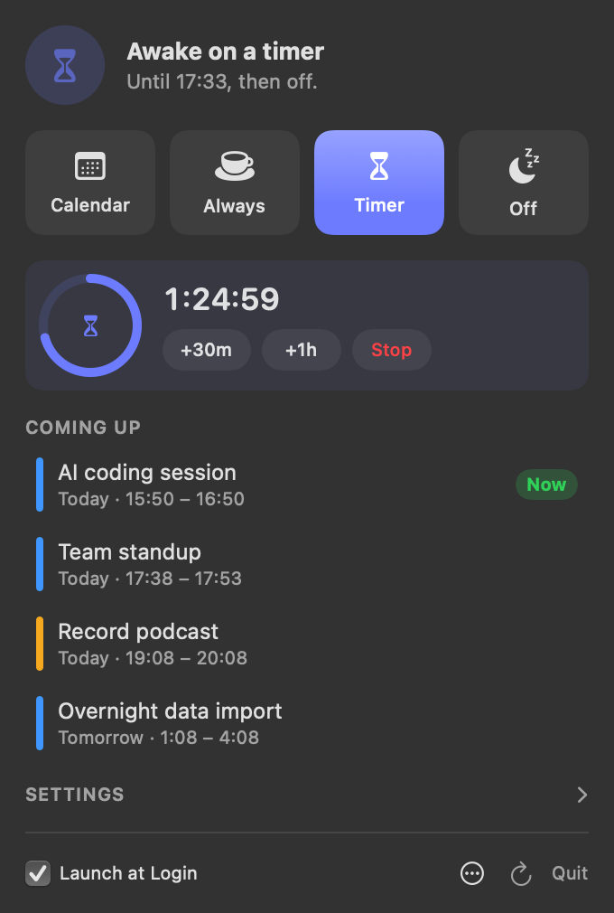

# ⏳ Timer

[← Back to the README](../../README.md#what-it-can-do)

Timer keeps your Mac awake for a set amount of time, then turns MacAwake off so your Mac sleeps as usual. It's for when you know roughly how long something will take but don't want to put it in your calendar.

  

## When to use it

- A download, export or build that will take about an hour.
- Letting an AI assistant finish a task while you step away for lunch.
- Watching a long video or presentation without the screen going dark.

## How to start a timer

1. Click the menu bar coffee cup ☕ to open the panel.
2. Click the **Timer** tile.
3. Under **Keep awake for**, pick how long: anything from 30 minutes to 12 hours.

The timer starts straight away.

## While it's running

- **The ring** fills up as time passes, and the time left is shown in the middle.
- **+30m** and **+1h** add more time if the job is taking longer than expected.
- **Stop** ends the timer early.
- **The menu bar icon** changes to an hourglass ⏳, so you can see a timer is running without opening the panel.

## When the time is up

When the timer runs out, or you press **Stop**, MacAwake switches to **Off** and your Mac sleeps as usual. It doesn't go back to Calendar mode on its own, so pick **Calendar** again if you want your events to keep your Mac awake.

## Good to know

- The timer keeps counting if you close the panel.
- **Closing a MacBook's lid** still puts it to sleep, unless it's connected to power and an external display.
- To keep the screen from dimming as well, turn on **Keep display on** in [Settings](settings.md).

## Related

- [Always on](always-on.md): stay awake with no time limit.
- [Off](off.md): what happens after the timer ends.
