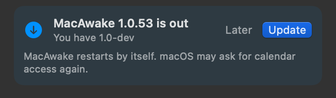

# ⬇️ Updates

[← Back to the README](../../README.md#what-it-can-do)

MacAwake tells you when a new version is out and installs it with one click. You don't need Terminal, and your Mac won't block the new version.

  

## How it works

- When MacAwake starts, and then once a day, it checks for a newer version.
- If there is one, a card appears in the panel, just above **Settings**.
- Click **Update**. MacAwake downloads the new version, checks that the download is complete and unchanged, puts it in place of the old one and restarts. Your settings stay as they are.
- Click **Later** to hide the card. It comes back when the next version is out.

If MacAwake is in a folder your account can't change, macOS asks for your Mac password before the update is installed.

## Check now

Click **⋯** at the bottom of the panel and choose **Check for Updates…**. The same menu shows which version you have.

## Turn it off

In **Settings**, switch off **Check for updates**. MacAwake then never checks by itself, and you can still check from the **⋯** menu.

## Good to know

- **Nothing is installed without you.** MacAwake only tells you about a new version; it installs it when you click **Update**.
- **Calendar access may be asked for again.** After an update, macOS sometimes forgets that you allowed MacAwake to see your calendars. If your events stop showing, click **Grant Access** in the panel.
- **Your Mac may sleep for a moment.** While MacAwake restarts, which takes a few seconds, it isn't keeping your Mac awake.
- **What the check sends:** one request to GitHub, where MacAwake is published, asking for the newest version. Nothing about you or your calendar is sent.
- The Terminal command from [Get started](../../README.md#get-started) also still updates MacAwake.

## Related

- [Settings and the menu bar](settings.md)
- The [Technical guide](../../TECHNICAL.md#updates) explains how updates are checked and installed.
