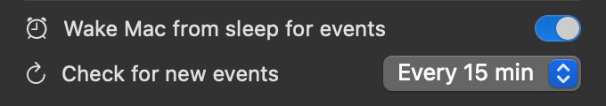

# ⏰ Wake from sleep

[← Back to the README](../../README.md#what-it-can-do)

[Calendar mode](calendar.md) keeps an awake Mac from falling asleep. Wake from sleep goes one step further: if your Mac has already gone to sleep, MacAwake wakes it up just before your next event starts.

  

## When to use it

- You scheduled an overnight job in your calendar and your Mac will be asleep by then.
- You leave your Mac to sleep between meetings, but want it awake for the next recording.

## How to set it up

1. Click the menu bar coffee cup ☕ to open the panel.
2. Click **Settings** to open it.
3. Next to **Wake from sleep**, click **Set Up…**.
4. Enter your Mac password when asked. You only need to do this once.

Waking a sleeping Mac needs a small helper with administrator rights, which is why macOS asks for your password. The helper can only plan or cancel MacAwake's own wake-ups; it never touches other apps' schedules.

Once it's set up, the Settings section shows **Wake Mac from sleep for events**, switched on:

  

When a wake-up is planned, the top of the panel shows **Wakes Mac at** and the time.

## Catching events added while your Mac sleeps

A sleeping Mac can't see new events. If you add one from your phone after your Mac went to sleep, MacAwake wouldn't know about it.

To catch these, MacAwake briefly wakes your Mac in the background every so often, with the screen off. It checks your calendar, plans a wake-up for any new event, and lets the Mac go back to sleep.

Choose how often under **Check for new events**:

| Option | Good for |
|---|---|
| **Every 5 min** | Catching last-minute events. Uses the most battery. |
| **Every 15 min** (default) | A balance for most people. |
| **Every 30 min** or **Every hour** | Saving battery when events are usually planned ahead. |
| **Never** | Only waking for events MacAwake already knew about. |

An event added less time before it starts than this interval might be missed. For example, with **Every 15 min**, an event added 10 minutes before it starts may not wake the Mac.

## Good to know

- Wake from sleep only works in **Calendar** mode.
- Checking for new events works best when your Mac is plugged in. On battery, macOS may end the check before your calendar has synced.
- **Closing a MacBook's lid** keeps it asleep, unless it's connected to power and an external display.
- **Quitting MacAwake** cancels any planned wake-up.
- To remove the helper, click the **⋯** button at the bottom of the panel and choose **Remove Wake Helper…**.

## Related

- [Calendar mode](calendar.md): which events count, and how to start early or finish late.
- [Settings](settings.md): every option in the panel.
- The [Technical guide](../../TECHNICAL.md) explains how the helper works and how to check it.
