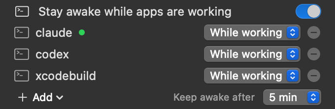

# 🤖 Stay awake while apps are working

[← Back to the README](../../README.md#what-it-can-do)

Pick the apps or tools you want MacAwake to watch, such as an AI coding agent. While one of them is busy, your Mac stays awake. When it finishes, MacAwake waits a few minutes and then lets your Mac sleep as usual. You don't have to guess how long the job will take.

  

## When to use it

- You've asked an AI coding agent, like Claude Code or Codex, to do a long task and you want to walk away.
- A build or export runs for a while and you don't know exactly how long.
- A meeting recorder should keep the Mac awake for as long as it's open.

## How to set it up

1. Click the menu bar coffee cup ☕ to open the panel, and make sure the **Calendar** tile is selected.
2. Click **Settings** to open it.
3. Turn on **Stay awake while apps are working**.
4. Click **Add** and choose what to watch:
   - **AI agents** adds the common command-line AI agents in one go (Claude Code, Codex, Gemini and others).
   - **Running apps** lists the apps you have open right now.
   - **Command…** lets you type the name of any command-line tool, such as a build tool.
5. For each one, choose when it counts:
   - **While working:** only while it's actually busy. An AI agent left open but idle doesn't keep your Mac awake. This is the default.
   - **While open:** whenever it's running, busy or not. Good for apps like meeting recorders.
6. Under **Keep awake after**, choose how long to stay awake once it finishes (5 minutes to start with). This covers short pauses, such as an agent waiting for a reply.

  

## What you'll see

- A **green dot** next to each watched item that's busy right now.
- **Awake for an app** at the top of the panel, with what's working, for example "While claude is working."
- When it finishes, the top of the panel says when your Mac will be allowed to sleep, for example "claude finished · sleeping after 3:42 PM".
- If a calendar event is on at the same time, the event is shown first, with "also claude" after it.

## Good to know

- Watched apps only count in **Calendar** mode. In Always and Timer your Mac is awake anyway, and **Off** always means off.
- They only work while the Mac is awake. A sleeping Mac can't run your apps, so they can't wake it up.
- Only your own apps and tools are watched, not other people's on the same Mac.
- To stop watching something, click the **−** button next to it.
- To keep your Mac awake for one particular job instead, whatever the mode, see [Stay awake while a job runs](run-a-job.md).

## Related

- [Calendar mode](calendar.md): watched apps add to your calendar events.
- [Keep running with the lid closed](lid-closed.md): let the agent keep going after you close a MacBook.
- [Settings](settings.md): every option in the panel.
- The [Technical guide](../../TECHNICAL.md#watched-apps-and-commands) explains how "working" is measured.
